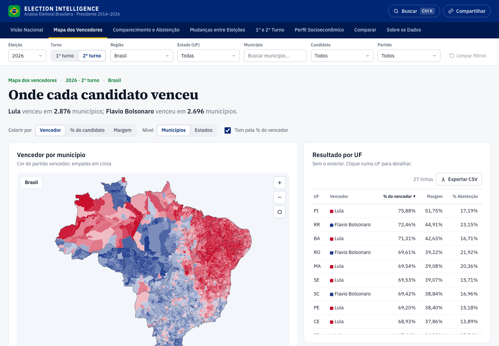
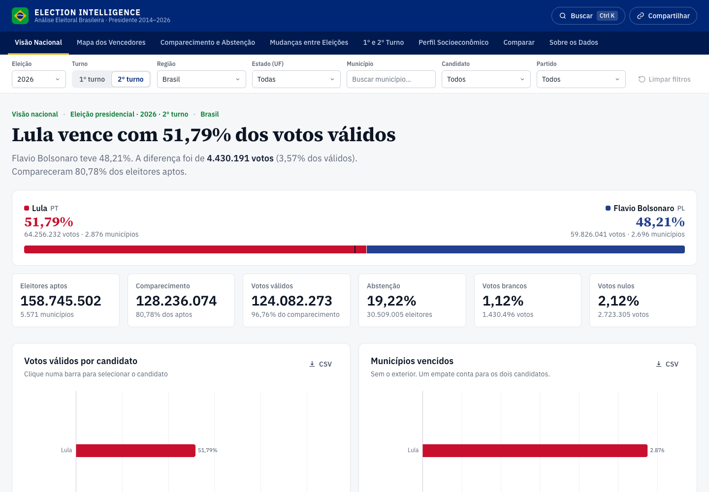
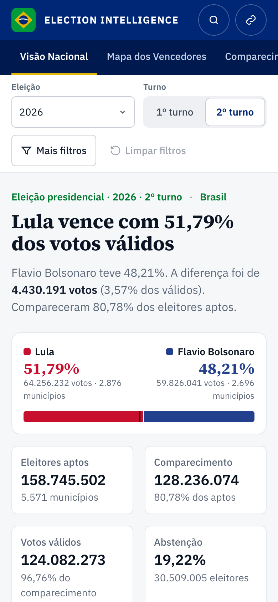
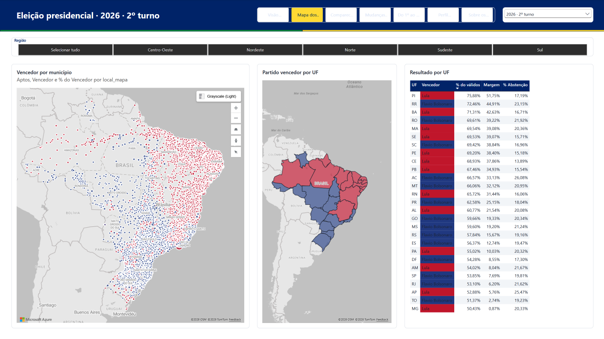

# Eleições presidenciais no Brasil (2014–2026)

[](https://eleicoes-presidenciais-br.vercel.app)
[](https://github.com/fernandofigueiredo-data/eleicoes-presidenciais-br/actions/workflows/deploy-election-intelligence.yml)


> Resultado da eleição para presidente em todos os 5.571 municípios, nas quatro últimas eleições
> (1º e 2º turnos), ligado a população, alfabetização e PIB do IBGE. Do arquivo bruto do TSE até um
> site interativo, com cada número conferido com a fonte.

**▶ [Abrir o site interativo](https://eleicoes-presidenciais-br.vercel.app)** · [Dashboard no Power BI](https://app.powerbi.com/view?r=eyJrIjoiNjlmZGIxNmItMDU5Yy00MzQ2LWE2YTYtYWMyZTE0OTRhMzM2IiwidCI6IjI2MGZmOWM5LTM4OGYtNDdiYi04NjlhLTc3YTk1N2JmNzA4MiJ9) · [Cópia no GitHub Pages](https://fernandofigueiredo-data.github.io/eleicoes-presidenciais-br/)

[](https://eleicoes-presidenciais-br.vercel.app/#/mapa)

## Em 30 segundos

| | |
|---|---|
| **Problema** | O TSE publica o resultado por zona eleitoral, em arquivos separados por eleição e turno, sem indicadores do município. Perguntas simples ("onde o vencedor virou no 2º turno?", "o voto muda com a renda do município?") exigem juntar, limpar e ligar 8 turnos a dados do IBGE. |
| **Dados** | 340.702 linhas (candidato × zona × turno), 5.571 municípios e 195 cidades do exterior, 2014, 2018, 2022 e 2026 |
| **O que construí** | Coleta automatizada (Python) → limpeza em modelo estrela (Pandas e Power Query) → banco relacional (SQL) → dashboard (Power BI, 55 medidas DAX) → **site independente** com mapa de todos os municípios (JavaScript) → versão em nuvem (Databricks) |
| **Resultado principal** | 2026 teve virada: Flavio Bolsonaro liderou o 1º turno (47,03%) e Lula venceu o 2º (51,79%), virando o resultado em 212 municípios |
| **Qualidade** | Totais iguais aos do TSE nos 8 turnos; **340 de 340** indicadores do site iguais aos do Power BI; 31 testes automatizados |

## Perguntas de negócio

1. Qual foi o resultado de cada eleição e turno, no país, por UF e por município?
2. Onde cada candidato venceu, e por qual margem?
3. Como a abstenção, os brancos e os nulos variam entre UFs e entre eleições?
4. Em quantos municípios o partido mais votado mudou de uma eleição para a outra? E do 1º para o 2º turno?
5. O voto varia conforme o perfil do município (PIB per capita, alfabetização, porte)?
6. Os números batem com o resultado oficial do TSE?

Para quem: jornalistas, analistas e pesquisadores que precisam do resultado oficial por território,
rápido e conferível, sem montar a base do zero.

## Principais resultados

- **2026 teve virada no 2º turno.** Flavio Bolsonaro liderou o 1º turno (47,03% contra 45,16%), e
  Lula venceu o 2º com 51,79% dos válidos (64.256.232 votos contra 59.826.041). Lula virou o
  resultado em 212 municípios que Flavio Bolsonaro tinha vencido no 1º turno, e Flavio Bolsonaro
  virou em 1.¹
- **O mapa ficou dividido.** No 2º turno de 2026, Lula venceu em 2.876 municípios e Flavio Bolsonaro
  em 2.695 (um município empatou).¹
- **O voto acompanha a renda do município.** No 2º turno de 2026, Lula teve 73,9% dos válidos no
  quarto de municípios com menor PIB per capita (até R$ 16.822) e 44,1% no quarto com maior PIB per
  capita (acima de R$ 49.825). A relação é com o município, não com o eleitor.
- **O partido vencedor mudou em menos municípios.** No 1º turno, mudou em 812 municípios de 2018
  para 2022 e em 714 de 2022 para 2026. PSL e PL contam como o mesmo campo, porque Bolsonaro trocou
  de sigla.¹
- **A abstenção ficou perto de 20% em todos os turnos** (de 19,22% a 21,30%). No 2º turno de 2026,
  foi maior no Acre (26,08%) e menor no Ceará (13,89%).

¹ Contagem estrita, sem empates. O Power BI e o site seguem a regra do DAX, em que um empate conta
como vitória dos dois e como virada ou mudança: por isso mostram 215 viradas, 2.696 municípios de
Flavio Bolsonaro, 813 e 716 mudanças. As duas contagens estão documentadas em
[`election-intelligence/docs/AUDITORIA_PBIX.md`](election-intelligence/docs/AUDITORIA_PBIX.md).

## Como os números foram validados

| Verificação | Como | Resultado |
|---|---|---|
| Totais × TSE | Comparecimento e votos válidos por turno comparados com o resultado oficial | Iguais nos 8 turnos |
| Integridade | Soma dos votos dos candidatos = votos válidos, em cada zona (`v_integridade_zona`) | Nenhuma zona divergente |
| Site × Power BI | 340 indicadores calculados dentro do PBIX (PBIX-MCP) comparados com o motor JavaScript | 340 / 340, diferença 0 |
| Testes do site | Vitest (13) e Playwright (18, desktop e celular), no build de produção | Todos passam a cada deploy |

## Decisões técnicas

| Decisão | Alternativa considerada | Por quê |
|---|---|---|
| Separar votos e comparecimento em duas tabelas de fato | Tabela única, como o dataset bruto | No bruto, o total da zona se repete em cada linha de candidato: somar ali multiplica o comparecimento |
| Percentual sempre como razão de somas | Média dos percentuais dos municípios | A média dá o mesmo peso a um município de 1 mil e a outro de 11 milhões de eleitores |
| PSL (2018) e PL (2022/2026) como o mesmo campo | Comparar siglas literalmente | Sem isso, a troca de partido do mesmo candidato apareceria como mudança em mais de mil municípios |
| Mapa em Canvas, ligado pelo código IBGE | SVG; geocodificação por nome (Azure Maps, no Power BI) | 5.570 polígonos em SVG travam o navegador; o código não falha com homônimos |
| Recalcular as medidas DAX no navegador | Pré-calcular todos os cruzamentos de filtros | São milhões de combinações de turno × território × candidato; o motor em JavaScript responde em milissegundos e é testado contra o próprio PBIX |
| Validar o site contra o PBIX com o PBIX-MCP | Conferir só os totais nacionais | Garante que UF, município, viradas e mudanças também batem, não só o Brasil |

## O que este projeto demonstra

| Competência | Onde ver |
|---|---|
| Coleta de dados públicos com rastreabilidade (SHA-256, versão do arquivo) | [`scripts/baixar_dados.py`](scripts/baixar_dados.py) |
| Limpeza e modelagem dimensional | [`notebooks/limpeza_dados.ipynb`](notebooks/limpeza_dados.ipynb), [`data/limpo/`](data/limpo/) |
| SQL: DDL, restrições, triggers, funções de janela, views | [`sql/schema.sql`](sql/schema.sql), [`diagrama/`](diagrama/) |
| Power BI: Power Query, 55 medidas DAX, design de relatório | [`powerbi/`](powerbi/) |
| Desenvolvimento web de dados: mapa de 5.570 municípios, filtros cruzados, CSV | [`election-intelligence/`](election-intelligence/) |
| Testes e validação automatizada | [`election-intelligence/tests/`](election-intelligence/tests/), [`docs/VALIDACAO.md`](election-intelligence/docs/VALIDACAO.md) |
| Nuvem: Databricks (Unity Catalog, AI/BI) | [`databricks/`](databricks/) |
| Comunicação: relatórios para quem não é técnico, limites declarados | este README e [`RELATORIO_FINAL.md`](election-intelligence/docs/RELATORIO_FINAL.md) |

## Entregas

| Etapa | Ferramenta | Onde está |
|---|---|---|
| Coleta e dataset | Python (biblioteca padrão) | [`scripts/`](scripts/) e [`data/`](data/) |
| Limpeza | Python, Pandas, Jupyter | [`notebooks/`](notebooks/) |
| Banco relacional | SQL (SQLite) | [`sql/`](sql/) |
| Modelo de dados | dbdiagram.io (DBML) | [`diagrama/`](diagrama/) |
| Dashboard | Power BI, Power Query, DAX | [`powerbi/`](powerbi/) · [online](https://app.powerbi.com/view?r=eyJrIjoiNjlmZGIxNmItMDU5Yy00MzQ2LWE2YTYtYWMyZTE0OTRhMzM2IiwidCI6IjI2MGZmOWM5LTM4OGYtNDdiYi04NjlhLTc3YTk1N2JmNzA4MiJ9) |
| Site interativo | Vite, JavaScript, ECharts, D3/Canvas, malhas do IBGE | [`election-intelligence/`](election-intelligence/) · [online](https://eleicoes-presidenciais-br.vercel.app) |
| Nuvem | Databricks (AI/BI Dashboard) | [`databricks/`](databricks/) |

## O site

8 páginas: visão nacional, mapa dos vencedores, comparecimento e abstenção, mudanças entre eleições,
1º e 2º turno, perfil socioeconômico, comparação lado a lado e fontes com conferência ao vivo.
Filtros de eleição, turno, região, UF, município, candidato e partido valem em todas as páginas e
ficam no link. Funciona no celular.

| Visão nacional | Mudanças entre eleições | Celular |
|---|---|---|
| [](https://eleicoes-presidenciais-br.vercel.app/#/nacional) | [](https://eleicoes-presidenciais-br.vercel.app/#/mudancas) | [](https://eleicoes-presidenciais-br.vercel.app) |

Detalhes, arquitetura e testes: [`election-intelligence/README.md`](election-intelligence/README.md).

## Dashboard Power BI



Prints das 7 páginas em [`prints/`](prints/) e navegação em vídeo em
[`prints/demo_dashboard.mov`](prints/demo_dashboard.mov). Passo a passo em
[`powerbi/guia_dashboard.md`](powerbi/guia_dashboard.md).

## Modelo de dados


Banco normalizado com 12 tabelas, chaves naturais, 10 views, índices e triggers de auditoria.
Fonte do diagrama: [`diagrama/modelo_relacional_eleicoes.dbml`](diagrama/modelo_relacional_eleicoes.dbml)
· [ver no dbdiagram.io](https://dbdiagram.io/d/6ae4915b8bf38111a8ea8f2e).

## Fluxo

```
TSE + IBGE ──► baixar_dados.py ──► gerar_dataset.py ──► eleicoes_presidente.csv
                                                              │
     ┌──────────────────┬──────────────────┬──────────────────┴───┐
     ▼                  ▼                  ▼                      ▼
limpeza_dados.ipynb  Power Query        carregar_banco.py     Databricks
     │                  │                  │                      │
     ▼                  ▼                  ▼                      ▼
data/limpo/*.csv     Power BI (.pbix)   eleicoes.db (SQL)     dashboard AI/BI
                        │
                        ▼  PBIX-MCP: tabelas, medidas DAX e layout
                     election-intelligence/ (site) ──► Vercel e GitHub Pages
```

A limpeza em Python e no Power Query é a mesma: gera as mesmas 5 tabelas, com os mesmos nomes de
colunas e o mesmo número de linhas.

## Estrutura do repositório

```
eleicoes-presidenciais-br/
├── README.md
├── requirements.txt                   dependências Python (notebook)
├── data/
│   ├── eleicoes_presidente.csv        dataset (22 colunas, 340.702 linhas)
│   ├── eleicoes_presidente.xlsx       o mesmo dataset em Excel
│   └── limpo/                         5 tabelas limpas do modelo estrela
├── scripts/                           coleta, geração do dataset e carga do banco
├── notebooks/limpeza_dados.ipynb      limpeza em Python (igual à do Power Query)
├── sql/schema.sql                     tabelas, views, índices e triggers
├── diagrama/                          modelo relacional (DBML, SQL, PNG, PDF)
├── powerbi/                           dashboard (.pbix), guia, medidas DAX e tema
├── prints/                            prints e vídeo do dashboard Power BI
├── databricks/                        dashboard AI/BI
├── election-intelligence/             site interativo (código, dados, testes e documentação)
└── .github/workflows/                 testes e publicação do site no GitHub Pages
```

Os arquivos brutos do TSE e do IBGE (`data/raw/`) e o banco (`data/eleicoes.db`) não vão para o
repositório: os scripts recriam os dois.

## Como executar

Python 3.10+ (os scripts usam só a biblioteca padrão; o notebook usa Pandas).

```bash
pip install -r requirements.txt
```

```bash
python3 scripts/carregar_banco.py           # cria data/eleicoes.db a partir do dataset versionado
```

Opcional, para refazer tudo a partir da fonte:

```bash
python3 scripts/baixar_dados.py && python3 scripts/gerar_dataset.py
```

Depois:

- **Limpeza:** rode `notebooks/limpeza_dados.ipynb` (gera `data/limpo/`).
- **SQL:** consulte as views, por exemplo `SELECT * FROM v_resultado_nacional;`.
- **Power BI:** abra `powerbi/eleicoes-presidenciais-br.pbix` no Power BI Desktop (Windows), aponte a
  consulta `Eleicoes` para o seu `data/eleicoes_presidente.csv` e clique em **Atualizar**.
- **Site:** `cd election-intelligence && npm install && npm run dev` (Node 20+).

## Principais decisões de limpeza

- Os totais de zona se repetem em cada linha de candidato: votos e comparecimento ficam em tabelas
  separadas, e as zonas são deduplicadas antes de somar.
- Exterior e Boa Esperança do Norte (MT) não têm dados do IBGE: os vazios não são preenchidos.
- Municípios com o mesmo nome são separados pelo código e pela UF.
- PSDC → DC (mesmo partido, nova sigla).

## Conferência com o TSE

| Turno | Comparecimento | Resultado (% dos válidos) |
|---|---|---|
| 2022 · 2º turno | 124.252.796 | Lula 50,90% · Jair Bolsonaro 49,10% |
| 2026 · 1º turno | 125.275.835 | Flavio Bolsonaro 47,03% · Lula 45,16% |
| 2026 · 2º turno | 128.236.074 | Lula 51,79% (64.256.232) · Flavio Bolsonaro 48,21% (59.826.041) |

As views `v_controle_nacional` e `v_integridade_zona` refazem essa conferência no banco, e a página
[Sobre os dados](https://eleicoes-presidenciais-br.vercel.app/#/sobre) do site a refaz no navegador.

## Limitações

- O 2º turno de 2026 (25/10/2026) vem dos arquivos que o TSE publicou em 28/10/2026. Se o TSE
  republicar, rode o fluxo de novo (`data/raw/manifesto.csv` guarda a versão usada).
- Em 2014 e 2018 faltam 684 e 470 eleitores aptos de zonas do exterior sem votos.
- O perfil econômico usa o PIB mais recente (2023) e a população de 2022.
- No Power BI (e, por isso, no site) a alfabetização é arredondada para inteiro pelo Power Query; o
  valor com decimais está em `data/limpo/dMunicipio.csv`.
- Indicadores descrevem o município, não o eleitor: associação não é causalidade, e resultados
  agregados não mostram para onde foi o voto de cada pessoa entre os turnos.

## Fontes dos dados

- TSE, Portal de Dados Abertos (licença CC-BY): https://dadosabertos.tse.jus.br
- IBGE: API de Localidades; Censo 2022 (SIDRA 4709 e 9543); PIB dos Municípios (SIDRA 5938):
  https://sidra.ibge.gov.br
- IBGE, API de Malhas Territoriais (mapa do site): https://servicodados.ibge.gov.br/api/docs/malhas

## Autor

Fernando Figueiredo · [github.com/fernandofigueiredo-data](https://github.com/fernandofigueiredo-data)
