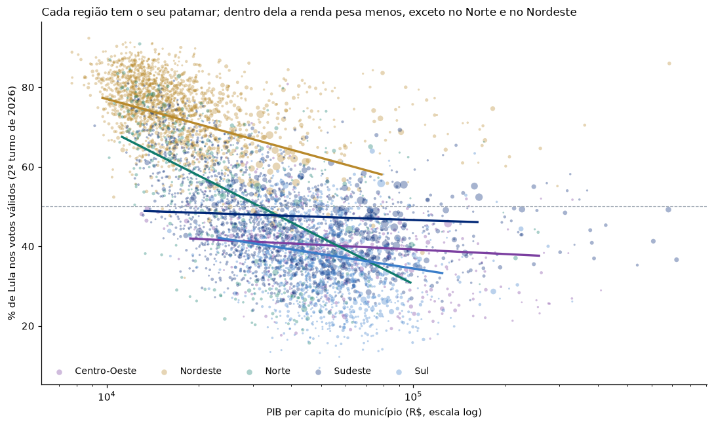
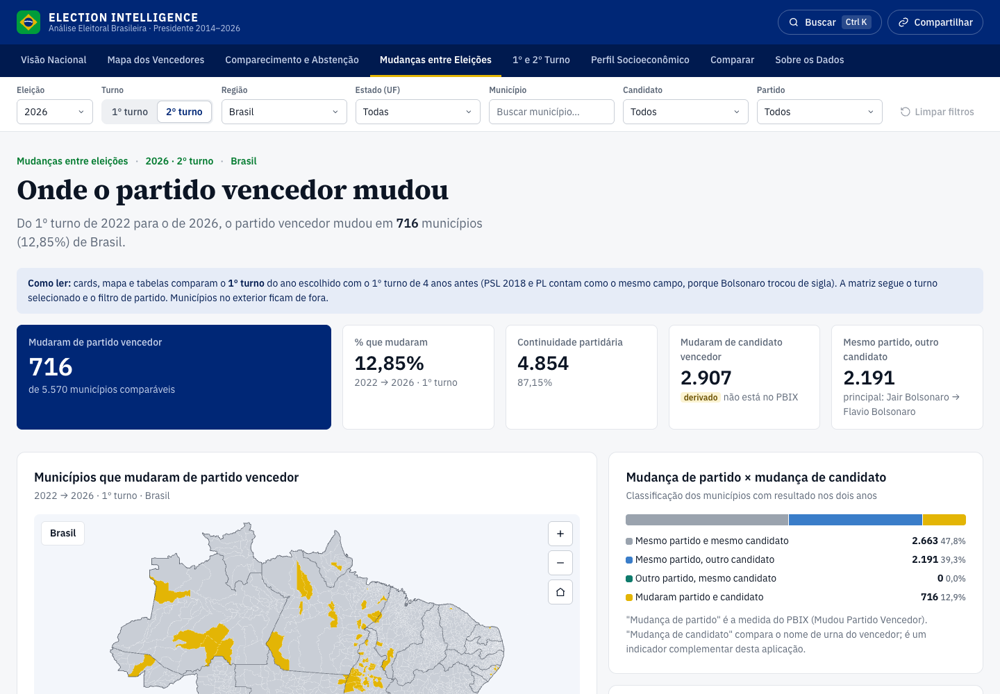
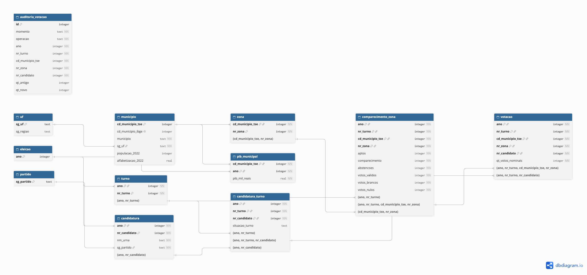

# Eleições presidenciais no Brasil (2014–2026)

[](https://eleicoes-presidenciais-br.vercel.app)
[](https://github.com/fernandofigueiredo-data/eleicoes-presidenciais-br/actions/workflows/python-pipeline.yml)
[](https://github.com/fernandofigueiredo-data/eleicoes-presidenciais-br/actions/workflows/deploy-election-intelligence.yml)
[](https://github.com/fernandofigueiredo-data/eleicoes-presidenciais-br/actions/workflows/site-testes-e2e.yml)
[](LICENSE)


> Resultado da eleição para presidente em todos os 5.571 municípios, nas quatro últimas eleições
> (1º e 2º turnos), ligado a população, alfabetização e PIB do IBGE. Do arquivo bruto do TSE até um
> site interativo, com cada número conferido com a fonte.

**▶ [Abrir o site interativo](https://eleicoes-presidenciais-br.vercel.app)** · [Dashboard no Power BI](https://app.powerbi.com/view?r=eyJrIjoiNjlmZGIxNmItMDU5Yy00MzQ2LWE2YTYtYWMyZTE0OTRhMzM2IiwidCI6IjI2MGZmOWM5LTM4OGYtNDdiYi04NjlhLTc3YTk1N2JmNzA4MiJ9) · [Cópia no GitHub Pages](https://fernandofigueiredo-data.github.io/eleicoes-presidenciais-br/)

[](https://eleicoes-presidenciais-br.vercel.app/mapa)

## Em 30 segundos

| | |
|---|---|
| **Problema** | O TSE publica o resultado por zona eleitoral, em arquivos separados por eleição e turno, sem indicadores do município. Perguntas simples ("onde o vencedor virou no 2º turno?", "o voto muda com a renda do município?") exigem juntar, limpar e ligar 8 turnos a dados do IBGE. |
| **Para quem** | Jornalistas, analistas e pesquisadores que precisam do resultado oficial por território, rápido e conferível. |
| **Dados** | 340.702 linhas (candidato × zona × turno), 5.571 municípios e 195 cidades do exterior, 2014, 2018, 2022 e 2026 · [baixar (CSV, Excel, SQLite)](https://github.com/fernandofigueiredo-data/eleicoes-presidenciais-br/releases/latest) |
| **O que construí** | Coleta automatizada (Python) → limpeza em modelo estrela (Pandas e Power Query) → banco relacional (SQL) → dashboard (Power BI, 55 medidas DAX) → análise estatística (regressão ponderada) → **site independente** com mapa de todos os municípios (JavaScript) |
| **Resultado principal** | 2026 teve virada: Flavio Bolsonaro liderou o 1º turno (47,03%) e Lula venceu o 2º (51,79%); 212 municípios trocaram de vencedor entre os turnos, 211 deles para Lula (contagem estrita; [por que há 212, 213 e 215](docs/divulgacao-election-intelligence/09_FAQ.md)) |
| **Qualidade** | Totais iguais aos do TSE nos 8 turnos; **340 de 340** indicadores do site iguais aos do Power BI; testes automatizados de pipeline, motor e interface, todos rodando no GitHub Actions |

## Principais resultados

- **2026 teve virada no 2º turno.** Flavio Bolsonaro liderou o 1º turno (47,03% contra 45,16%), e
  Lula venceu o 2º com 51,79% dos válidos (64.256.232 votos contra 59.826.041). Entre os turnos,
  215 municípios trocaram de vencedor: 213 para Lula, 1 para Flavio Bolsonaro e 1 que empatou no
  2º turno. Sem os 3 casos que envolvem empate, são 212.¹
- **O mapa ficou dividido.** No 2º turno de 2026, Lula venceu em 2.876 municípios e Flavio Bolsonaro
  em 2.696; o único município empatado conta para os dois.¹
- **A renda do município importa menos do que parece; a região importa mais.** Lula teve 73,9% dos
  válidos no quarto de municípios com menor PIB per capita e 44,1% no quarto com maior. Sozinho,
  dobrar o PIB per capita acompanha 8,8 pontos a menos para Lula. Com alfabetização e região no
  modelo, o efeito cai para 1,7 ponto e deixa de ser estatisticamente distinguível de zero (IC 95% com
  erros agrupados por UF: −4,0 a +0,6; p = 0,15), enquanto o R² sobe de 0,33 para 0,65. Com renda e
  alfabetização iguais, um município do Nordeste ainda dá a Lula 21 pontos a mais do que um do
  Centro-Oeste. O resultado se repete em 2022. → [`notebooks/analise_perfil.ipynb`](notebooks/analise_perfil.ipynb)
- **O partido vencedor mudou em menos municípios.** No 1º turno, mudou em 813 municípios de 2018
  para 2022 e em 716 de 2022 para 2026 (4 e 5 deles por empate). PSL e PL contam como o mesmo campo,
  porque Bolsonaro trocou de sigla.¹
- **A abstenção ficou perto de 20% em todos os turnos** (de 19,22% a 21,30%). No 2º turno de 2026,
  foi maior no Acre (26,08%) e menor no Ceará (13,89%).

¹ Empates seguem a regra do Power BI, a mesma do site: um empate conta como vitória dos dois
candidatos e como virada ou mudança. O banco SQL desempata pelo número do candidato (Lula, 13, antes
de Flavio Bolsonaro, 22) e por isso conta 213 viradas; ver [`sql/README.md`](sql/README.md).



## Caso de uso: onde Lula virou em Minas Gerais?

Minas foi o estado mais apertado de 2026: Flavio Bolsonaro venceu lá no 1º turno, com Lula em 43,33%,
e Lula venceu o 2º com 50,43%, por 0,87 ponto. Para saber onde a virada aconteceu:

1. Abra a página [1º e 2º turno filtrada por Minas Gerais](https://eleicoes-presidenciais-br.vercel.app/turnos?uf=MG).
2. O cartão mostra **76 dos 853 municípios** (8,9%) que trocaram de vencedor, todos de Flavio Bolsonaro
   para Lula; o mapa mostra onde eles ficam.
3. Ordene a lista por eleitores aptos: os maiores são Ribeirão das Neves, Santa Luzia, Ibirité, Sabará
   e Nova Lima, todos na região metropolitana de Belo Horizonte. Clique num deles para ver o resultado
   nos dois turnos, ou exporte a lista em CSV.

O link já traz o filtro: dá para mandar a mesma visão para outra pessoa.

## Como os números foram validados

| Verificação | Como | Resultado |
|---|---|---|
| Totais × TSE | Comparecimento e votos válidos de cada turno contra o resultado oficial (ex.: 2026 · 2º turno, 128.236.074 e 124.082.273) | Iguais nos 8 turnos |
| Integridade | Soma dos votos dos candidatos = votos válidos, em cada zona (`v_integridade_zona`) e em cada município | Nenhuma divergência |
| Reprodutibilidade | A CI roda `limpeza_dados.ipynb` e exige que `data/limpo/` saia idêntico ao versionado | Idêntico, byte a byte |
| Site × Power BI | 340 indicadores calculados dentro do PBIX (PBIX-MCP) contra o motor JavaScript do site | 340 / 340, diferença 0 |
| Testes | pytest (20, pipeline Python e números da divulgação), Vitest (36, motor, critérios de contagem e carregamento) e Playwright (113, desktop e celular, incluindo os 27 links por UF) | Todos passam na CI (pytest no pipeline Python; Vitest e Playwright no workflow do site) |

## Decisões técnicas

| Decisão | Alternativa considerada | Por quê |
|---|---|---|
| Separar votos e comparecimento em duas tabelas de fato | Tabela única, como o dataset bruto | No bruto, o total da zona se repete em cada linha de candidato: somar ali multiplica o comparecimento |
| Percentual sempre como razão de somas | Média dos percentuais dos municípios | A média dá o mesmo peso a um município de 1 mil e a outro de 11 milhões de eleitores |
| PSL (2018) e PL (2022/2026) como o mesmo campo | Comparar siglas literalmente | Sem isso, a troca de partido do mesmo candidato apareceria como mudança em mais de mil municípios |
| Regressão ponderada pelos votos, com controle por região e erros agrupados por UF | Comparar quartis de renda; erros que tratam cada município como independente | Os quartis misturam renda com região e escolaridade. Municípios do mesmo estado votam parecido: sem agrupar, o intervalo exclui o zero e a conclusão seria otimista demais |
| Mapa em Canvas, ligado pelo código IBGE | SVG; geocodificação por nome (Azure Maps, no Power BI) | 5.570 polígonos em SVG travam o navegador; o código não falha com homônimos |
| Recalcular as medidas DAX no navegador | Pré-calcular todos os cruzamentos de filtros | São milhões de combinações de turno × território × candidato; o motor responde em milissegundos e é testado contra o próprio PBIX |

## O que este projeto demonstra

| Competência | Ferramenta | Onde ver |
|---|---|---|
| Coleta de dados públicos com rastreabilidade (SHA-256, versão do arquivo) | Python (biblioteca padrão) | [`scripts/`](scripts/) |
| Limpeza e modelagem dimensional | Pandas, Jupyter, Power Query | [`notebooks/limpeza_dados.ipynb`](notebooks/limpeza_dados.ipynb), [`data/limpo/`](data/limpo/) |
| Estatística aplicada com limites declarados | statsmodels, SciPy | [`notebooks/analise_perfil.ipynb`](notebooks/analise_perfil.ipynb) |
| SQL: DDL, restrições, triggers, funções de janela, views | SQLite | [`sql/schema.sql`](sql/schema.sql), [`diagrama/`](diagrama/) |
| BI: modelo estrela, 55 medidas DAX, design de relatório | Power BI | [`powerbi/`](powerbi/) · [online](https://app.powerbi.com/view?r=eyJrIjoiNjlmZGIxNmItMDU5Yy00MzQ2LWE2YTYtYWMyZTE0OTRhMzM2IiwidCI6IjI2MGZmOWM5LTM4OGYtNDdiYi04NjlhLTc3YTk1N2JmNzA4MiJ9) |
| Produto de dados na web: mapa de 5.570 municípios, filtros cruzados, CSV | Vite, JavaScript, ECharts, D3 | [`election-intelligence/`](election-intelligence/) · [online](https://eleicoes-presidenciais-br.vercel.app) |
| Testes e CI | pytest, Vitest, Playwright, GitHub Actions | [`tests/`](tests/), [`election-intelligence/tests/`](election-intelligence/tests/), [`.github/workflows/`](.github/workflows/) |
| Nuvem | Databricks (Unity Catalog, AI/BI) | [`databricks/`](databricks/) |

## O site

8 páginas: visão nacional, mapa dos vencedores, comparecimento e abstenção, mudanças entre eleições,
1º e 2º turno, perfil socioeconômico, comparação lado a lado e sobre e contato (fontes, como citar, perguntas frequentes e conferência ao vivo).
Filtros de eleição, turno, região, UF, município, candidato e partido valem em todas as páginas e
ficam no link. Funciona no celular. Detalhes: [`election-intelligence/README.md`](election-intelligence/README.md).

| Visão nacional | Mudanças entre eleições | Celular |
|---|---|---|
| [](https://eleicoes-presidenciais-br.vercel.app/) | [](https://eleicoes-presidenciais-br.vercel.app/mudancas) | [](https://eleicoes-presidenciais-br.vercel.app) |

O dashboard original em Power BI tem 7 páginas: prints em [`prints/`](prints/), vídeo em
[`prints/demo_dashboard.mov`](prints/demo_dashboard.mov) e passo a passo em
[`powerbi/guia_dashboard.md`](powerbi/guia_dashboard.md).

## Limitações

- O 2º turno de 2026 (25/10/2026) vem dos arquivos que o TSE publicou em 28/10/2026. Se o TSE
  republicar, rode o fluxo de novo (`data/raw/manifesto.csv` guarda a versão usada).
- Em 2014 e 2018 faltam 684 e 470 eleitores aptos de zonas do exterior sem votos.
- O perfil econômico usa o PIB mais recente (2023) e a população de 2022. Exterior e Boa Esperança do
  Norte (MT) não têm dados do IBGE.
- No Power BI (e, por isso, no site) a alfabetização é arredondada para inteiro pelo Power Query; o
  notebook de análise usa o valor com decimais de `data/limpo/`.
- Indicadores descrevem o município, não o eleitor: associação não é causalidade, e resultados
  agregados não mostram para onde foi o voto de cada pessoa entre os turnos. A regressão não inclui
  variáveis como religião, idade ou urbanização.

## Detalhes técnicos

<details>
<summary><strong>Como executar</strong></summary>

Python 3.10+ e, para o site, Node 20+.

```bash
pip install -r requirements.txt
```

```bash
python3 scripts/carregar_banco.py           # cria data/eleicoes.db a partir do dataset versionado (~4 s)
```

```bash
pytest -q tests                             # 20 testes: tabelas, totais do TSE, banco SQL, regressão e UTM
```

Para refazer tudo a partir da fonte: `python3 scripts/baixar_dados.py && python3 scripts/gerar_dataset.py`.

- **Limpeza:** `notebooks/limpeza_dados.ipynb` (gera `data/limpo/`).
- **Análise estatística:** `notebooks/analise_perfil.ipynb`.
- **SQL:** consulte as views, por exemplo `SELECT * FROM v_resultado_nacional;`.
- **Power BI:** abra `powerbi/eleicoes-presidenciais-br.pbix` no Power BI Desktop (Windows), aponte a
  consulta `Eleicoes` para o seu `data/eleicoes_presidente.csv` e clique em **Atualizar**.
- **Site:** `cd election-intelligence && npm install && npm run dev`.

</details>

<details>
<summary><strong>Fluxo dos dados</strong></summary>

```
TSE + IBGE ──► baixar_dados.py ──► gerar_dataset.py ──► eleicoes_presidente.csv
                                                              │
     ┌──────────────────┬──────────────────┬──────────────────┴───┐
     ▼                  ▼                  ▼                      ▼
limpeza_dados.ipynb  Power Query        carregar_banco.py     Databricks
     │                  │                  │                      │
     ▼                  ▼                  ▼                      ▼
data/limpo/*.csv     Power BI (.pbix)   eleicoes.db (SQL)     dashboard AI/BI
     │                  │
     ▼                  ▼  PBIX-MCP: tabelas, medidas DAX e layout
analise_perfil.ipynb  election-intelligence/ (site) ──► Vercel e GitHub Pages
```

A limpeza em Python e no Power Query gera as mesmas 5 tabelas, com os mesmos nomes de colunas e o
mesmo número de linhas.

</details>

<details>
<summary><strong>Modelo de dados</strong></summary>



Banco normalizado com 12 tabelas, chaves naturais, 10 views, índices e triggers de auditoria. Fonte:
[`diagrama/modelo_relacional_eleicoes.dbml`](diagrama/modelo_relacional_eleicoes.dbml)
· [ver no dbdiagram.io](https://dbdiagram.io/d/6ae4915b8bf38111a8ea8f2e).

Decisões de limpeza: zonas deduplicadas antes de somar o comparecimento; vazios do IBGE não são
preenchidos; municípios homônimos separados pelo código e pela UF; PSDC → DC (mesmo partido, nova sigla).

</details>

<details>
<summary><strong>Estrutura do repositório</strong></summary>

```
eleicoes-presidenciais-br/
├── README.md, LICENSE, requirements.txt
├── data/
│   ├── eleicoes_presidente.csv        dataset (22 colunas, 340.702 linhas)
│   ├── eleicoes_presidente.xlsx       o mesmo dataset em Excel
│   └── limpo/                         5 tabelas limpas do modelo estrela
├── scripts/                           coleta, geração do dataset e carga do banco
├── notebooks/
│   ├── limpeza_dados.ipynb            limpeza em Python (igual à do Power Query)
│   ├── analise_perfil.ipynb           renda × voto com regressão e controles
│   └── figuras/
├── sql/schema.sql                     tabelas, views, índices e triggers
├── diagrama/                          modelo relacional (DBML, SQL, PNG, PDF)
├── powerbi/                           dashboard (.pbix), guia, medidas DAX e tema
├── prints/                            prints e vídeo do dashboard Power BI
├── databricks/                        dashboard AI/BI
├── tests/                             testes do pipeline Python (pytest)
├── election-intelligence/             site interativo (código, dados, testes e documentação)
└── .github/workflows/                 CI do pipeline Python e do site
```

Os arquivos brutos do TSE e do IBGE (`data/raw/`) e o banco (`data/eleicoes.db`) não vão para o
repositório: os scripts recriam os dois.

</details>

## Fontes e licença

- TSE, Portal de Dados Abertos (licença CC-BY): https://dadosabertos.tse.jus.br
- IBGE: API de Localidades; Censo 2022 (SIDRA 4709 e 9543); PIB dos Municípios (SIDRA 5938):
  https://sidra.ibge.gov.br; API de Malhas Territoriais (mapa do site)

Código sob a [licença MIT](LICENSE). Os dados seguem as licenças das fontes (cite o TSE e o IBGE).

## Aviso, como citar e contato

O ELECTION INTELLIGENCE é um projeto independente de análise e visualização de dados. **Não é fonte
oficial do Tribunal Superior Eleitoral (TSE) nem do IBGE.** Para resultados oficiais, consulte o
[portal de resultados do TSE](https://resultados.tse.jus.br/).

**Como citar** (os três formatos, com botão de copiar, estão em
[Sobre e contato](https://eleicoes-presidenciais-br.vercel.app/sobre?s=citar)):

- Fonte em matéria ou gráfico: `Fonte: TSE e IBGE. Elaboração: ELECTION INTELLIGENCE (https://eleicoes-presidenciais-br.vercel.app/).`
- Referência (ABNT): `FIGUEIREDO, Fernando. ELECTION INTELLIGENCE: análise eleitoral brasileira. [S. l.], 2026. Disponível em: https://eleicoes-presidenciais-br.vercel.app/. Acesso em: <data>.`

Cite o TSE e o IBGE como fontes dos dados e o projeto como ferramenta. Confirme os números oficiais
no TSE antes de publicar. Para reproduzir um recorte, copie o link da página: os filtros ficam no
endereço. Ao citar viradas entre turnos, informe o critério (veja as
[perguntas frequentes](docs/divulgacao-election-intelligence/09_FAQ.md)).

**Contato:** Fernando Figueiredo · [fernandofigueiredo123@gmail.com](mailto:fernandofigueiredo123@gmail.com?subject=Contato%20sobre%20o%20ELECTION%20INTELLIGENCE).
Respostas podem levar alguns dias.

## Autor

**Fernando Figueiredo**

[](https://www.linkedin.com/in/fernandofigueiredoalves/)
[](mailto:fernandofigueiredo123@gmail.com)
[](https://github.com/fernandofigueiredo-data)
