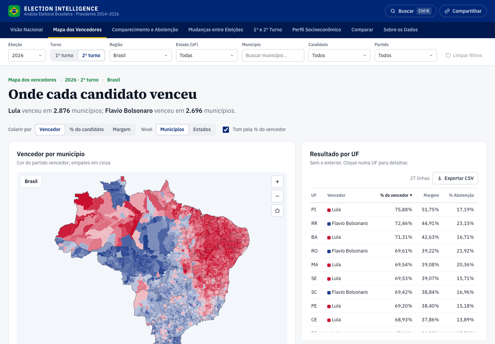

# ELECTION INTELLIGENCE — Análise Eleitoral Brasileira

Site independente (HTML, CSS e JavaScript, sem Power BI) que reconstrói e amplia o relatório
`powerbi/eleicoes-presidenciais-br.pbix`: eleições para presidente de 2014 a 2026, 1º e 2º turnos,
em todos os 5.570 municípios com malha oficial do IBGE.



## Páginas

| # | Página | Destaques |
|---|---|---|
| 01 | Visão Nacional | KPIs, faixa do resultado, votos e municípios vencidos por candidato, série histórica, cartograma das UFs, ranking |
| 02 | Mapa dos Vencedores | Mapa de 5.570 municípios em Canvas, Brasil → Região → UF → Município, modos vencedor / % do candidato / margem, tabelas por UF e município |
| 03 | Comparecimento e Abstenção | Mapa por UF ou município, ranking das UFs com média Brasil, abstenção × alfabetização, séries por região, brancos e nulos |
| 04 | Mudanças entre Eleições | Mapa de mudança de partido, partido × candidato, transições, lista, % por UF, matriz de variação p.p. |
| 05 | 1º e 2º Turno | Viradas, tabela de candidatos, mapa, lista, variação por UF, viradas por UF |
| 06 | Perfil Socioeconômico | Votos por quartil de PIB per capita, de alfabetização e por porte; dispersão PIB × voto |
| 07 | Comparar | Candidatos e territórios lado a lado |
| 08 | Sobre os Dados | Fontes, método, limitações, conferência com o TSE, **validação ao vivo contra o PBIX-MCP**, 55 medidas DAX |

Filtros globais (eleição, turno, região, UF, município, candidato, partido) persistem entre páginas e
ficam na URL (botão **Compartilhar**). Busca com **Ctrl/⌘ + K** ou **/**. Toda tabela e gráfico exporta CSV.

## Executar

Requisitos: Node 20+ (testado com 24) e Python 3.10+ (só para regerar os dados).

```bash
cd election-intelligence
```

```bash
npm install
```

```bash
npm run dev
```

Abre em http://localhost:5173. Outros comandos:

| Comando | O que faz |
|---|---|
| `npm run build` | Build de produção em `dist/` |
| `npm run preview` | Serve `dist/` em http://localhost:4173 |
| `npm run data` | Regera `public/data/` a partir de `data/raw/` (exportação do PBIX) |
| `npm run validate` | Compara o motor JS com os valores do PBIX-MCP (`docs/validacao_resultados.json`) |
| `npm test` | Testes unitários (Vitest) |
| `npm run test:e2e` | Testes de ponta a ponta (Playwright). Sem os navegadores do Playwright, use `PW_CHANNEL=chrome npm run test:e2e` (Chrome instalado) ou `npx playwright install chromium` |

## Publicar

O build usa caminhos relativos (`base: './'`): a mesma pasta `dist/` funciona em qualquer host estático.

- **GitHub Pages:** o workflow `.github/workflows/deploy-election-intelligence.yml` (na raiz do repositório)
  testa, valida, gera o build e publica a cada push na `main`. Em *Settings → Pages*, escolha
  *Source: GitHub Actions*.
- **Netlify:** *Base directory* `election-intelligence`; o resto está em `netlify.toml`.
- **Vercel:** *Root Directory* `election-intelligence`; o resto está em `vercel.json`.
- **Qualquer servidor estático:** `npm run build` e copie `dist/`.

## Atualizar os dados sem mexer no frontend

1. Atualize o PBIX e exporte as tabelas com o PBIX-MCP (`pbix_export_all_tables_csv` → `data/raw/`).
2. `npm run data` e `npm run validate`.
3. Substitua a pasta `data/` do site publicado pelo novo `public/data/` (ou rode o build).

Detalhes em [`docs/METODOLOGIA.md`](docs/METODOLOGIA.md#7-atualização-dos-dados-sem-reconstruir-o-frontend).

## Estrutura

```
election-intelligence/
├── index.html, vite.config.js, package.json, playwright.config.js, netlify.toml, vercel.json
├── data/
│   ├── raw/          tabelas exportadas do PBIX pelo PBIX-MCP (sem alteração)
│   ├── metadata/     TMDL, layout do relatório, tema, referência DAX avaliada pelo MCP
│   └── geo_src/      malhas brutas do IBGE (não versionado; scripts/fetch_geo.sh)
├── public/
│   ├── data/         camada processada (JSON) lida pelo navegador
│   ├── geo/          TopoJSON de municípios e UFs (IBGE)
│   └── assets/
├── scripts/          build_data.py, fetch_geo.sh, validate.mjs
├── src/
│   ├── main.js, app.js           carga, shell e roteamento
│   ├── services/                 data.js, engine.js (medidas DAX), geo.js, validation.js
│   ├── state/store.js            estado global + URL
│   ├── components/               cards, charts, maps, tables, filters, navigation, ui
│   ├── pages/                    uma página por arquivo (carregadas sob demanda)
│   ├── utils/                    format, csv, colors, dom
│   └── styles/                   tokens, base, layout, components
├── tests/                        engine.test.js (Vitest) e e2e/ (Playwright)
└── docs/                         AUDITORIA_PBIX, AUDITORIA_DESIGN, DICIONARIO_DADOS, METODOLOGIA, VALIDACAO, RELATORIO_FINAL, prints/

Design system: [`DESIGN.md`](DESIGN.md) (tokens, tipografia, componentes) e [`PRODUCT.md`](PRODUCT.md) (público e tarefas). Auditoria de design: [`docs/AUDITORIA_DESIGN.md`](docs/AUDITORIA_DESIGN.md).
```

## Dependências

| Pacote | Uso |
|---|---|
| `echarts` 5.6 | Gráficos (importação modular) |
| `d3-geo`, `d3-zoom`, `d3-selection`, `d3-scale`, `d3-array` | Projeção, zoom/arraste e escalas do mapa |
| `topojson-client` | Leitura das malhas TopoJSON |
| `@fontsource-variable/ibm-plex-sans`, `@fontsource-variable/source-serif-4` | Fontes embutidas (sem CDN) |
| `vite` (dev) | Servidor e build |
| `vitest`, `@playwright/test` (dev) | Testes |

Fontes dos dados: TSE (Dados Abertos, CC-BY) e IBGE (Censo 2022, PIB dos Municípios, API de Malhas).
