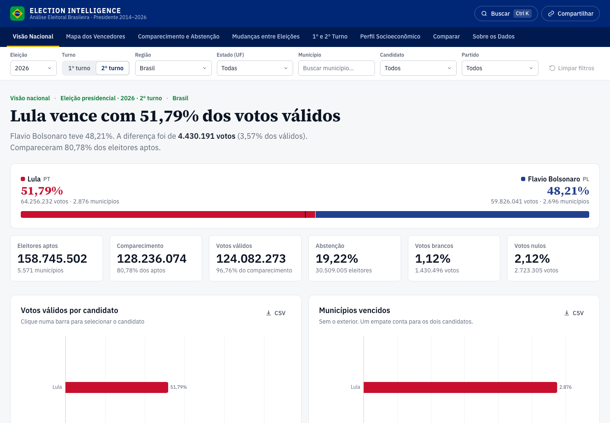
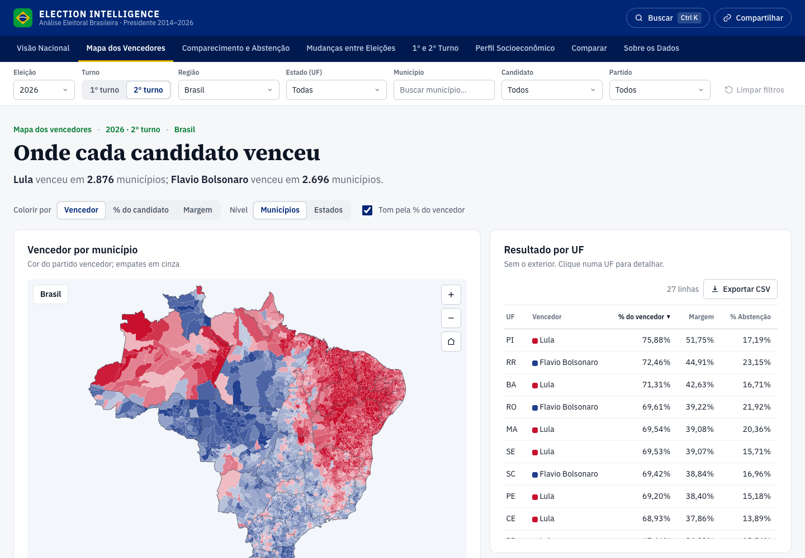
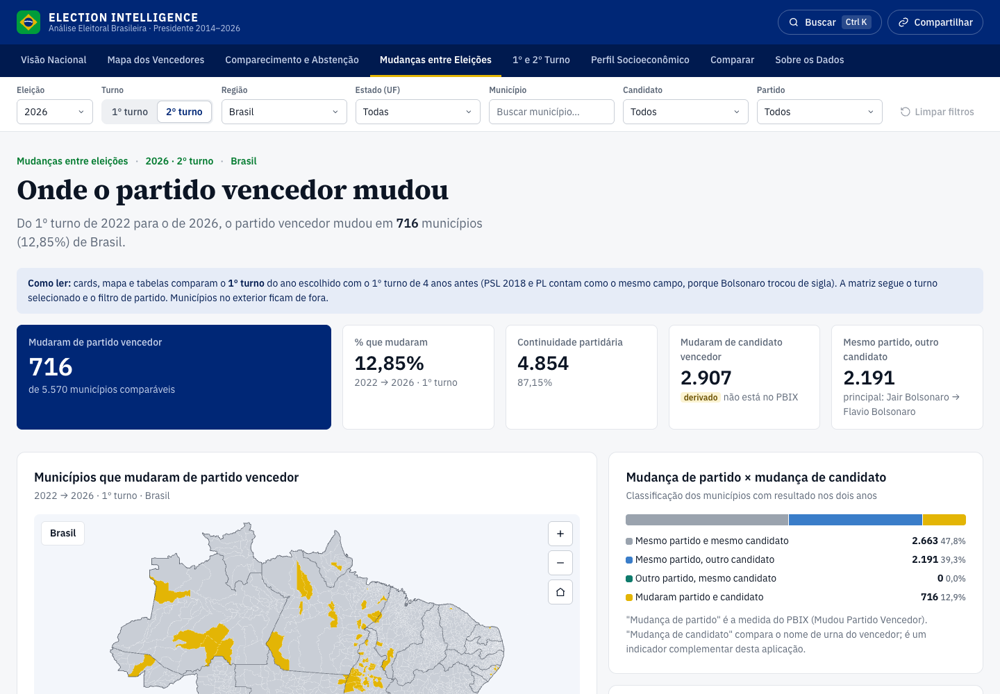
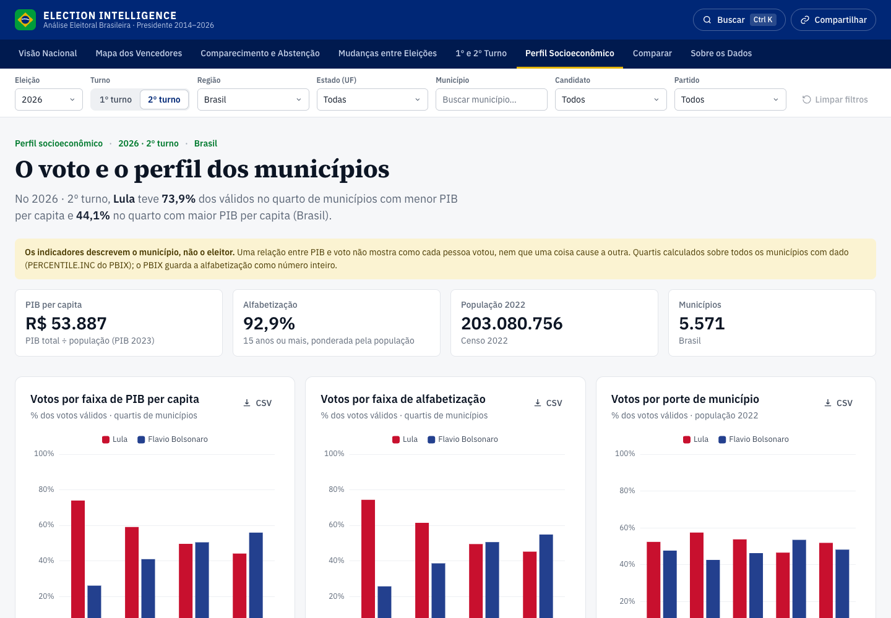
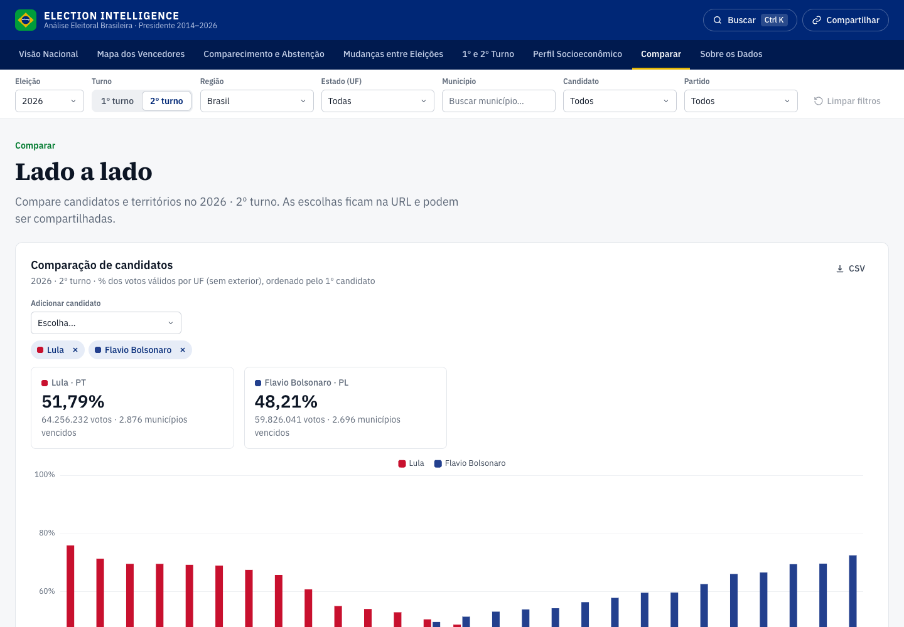
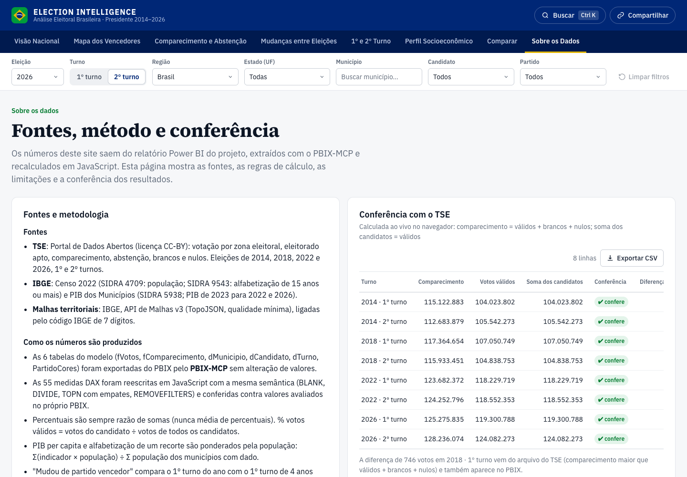

# Relatório final — ELECTION INTELLIGENCE

18/11/2026 · reconstrução do relatório `powerbi/eleicoes-presidenciais-br.pbix` como site independente.

## 1. Resultado

Um site estático (Vite + JavaScript ES2020 + ECharts + D3/Canvas + TopoJSON) com **8 páginas**: as 7
páginas analíticas do relatório original (a dica de ferramenta "Dica do município" virou o tooltip e o
painel de detalhe do município) e a página nova **Comparar**. Funciona sem Power BI, em qualquer host
estático, no desktop e no celular.

| Página | Print |
|---|---|
| 01 Visão Nacional |  |
| 02 Mapa dos Vencedores |  |
| 03 Comparecimento e Abstenção |  |
| 04 Mudanças entre Eleições |  |
| 05 1º e 2º Turno |  |
| 06 Perfil Socioeconômico |  |
| 07 Comparar |  |
| 08 Sobre os Dados |  |
| Celular |   |

Design system e auditoria de design (método Impeccable): [`../DESIGN.md`](../DESIGN.md), [`AUDITORIA_DESIGN.md`](AUDITORIA_DESIGN.md).

## 2. Como o PBIX-MCP foi usado

1. **Conexão e diagnóstico:** `pbix_open`, inventário de tabelas, colunas, medidas, relações, Power Query,
   fontes, hierarquias, colunas ordenadas, páginas e visuais.
2. **Extração:** `pbix_export_all_tables_csv` (6 tabelas, 365.020 linhas → `data/raw/`), `pbix_export_tmdl`
   (modelo completo), `pbix_get_layout_raw` (layout), `pbix_get_theme`.
3. **Validação DAX:** `pbix_evaluate_dax`, `_grouped`, `_per_dimension`, `_batch` → 340 valores de referência.
4. **Fallback documentado:** as interações entre visuais (`visualInteractions`) não vêm no layout do MCP; os
   `page.json` foram lidos do pacote em modo somente leitura. O PBIX não foi modificado.

Detalhes em [`AUDITORIA_PBIX.md`](AUDITORIA_PBIX.md).

## 3. Validações

| Evidência | Resultado |
|---|---|
| Indicadores JS × PBIX-MCP | **340 / 340**, diferença máxima **0** (inclui verificação cega) |
| Testes unitários (Vitest) | **13 / 13** |
| Testes de ponta a ponta (Playwright, build de produção, desktop + Pixel 5) | **18 / 18** |
| Console do navegador | sem erros nas 8 páginas (teste automatizado) |
| Responsividade | 8 páginas sem rolagem horizontal a 393 px |
| Build | `npm run build` gera `dist/` (JS principal 35 kB, ECharts 562 kB → 187 kB gzip, carregado só com gráficos) |

Tabela completa em [`VALIDACAO.md`](VALIDACAO.md). A mesma validação roda ao vivo na página
**Sobre os dados**.

Principais números conferidos (2026 · 2º turno): 158.745.502 aptos · 128.236.074 comparecimento ·
Lula 51,79% (64.256.232) × Flavio Bolsonaro 48,21% (59.826.041) · 2.876 e 2.696 municípios vencidos ·
215 viradas · 716 municípios mudaram de partido vencedor (1º turno 2022 → 2026) · abstenção 19,22%,
maior no Acre (26,08%) e menor no Ceará (13,89%).

## 4. Requisitos atendidos

| Requisito | Onde |
|---|---|
| Todas as páginas analíticas | `src/pages/` (nacional, mapa, participacao, mudancas, turnos, perfil, sobre) |
| Mapa real com códigos IBGE, 5.570 municípios, drill Brasil → Região → UF → Município | `components/maps/canvasMap.js`, `territoryMap.js` |
| Filtros globais (eleição, turno, candidato, partido, região, UF, município), cascata e persistência | `components/filters/filterBar.js`, `state/store.js` |
| Busca inteligente | `components/filters/searchPalette.js` |
| Tooltips, seleção cruzada (clique em barra, linha, UF, ponto ou polígono filtra o resto) | páginas |
| Ordenação de tabelas e exportação CSV | `components/tables/dataTable.js`, botões CSV nos gráficos |
| Comparação de candidatos e territórios | `pages/comparar.js` |
| Filtros na URL / compartilhamento | `state/store.js`, botão Compartilhar |
| Limpar filtros | barra de filtros |
| Mudança de partido ≠ mudança de candidato | página 04 (indicador derivado marcado como tal) |
| Sem transferência de votos inferida, sem causalidade | avisos nas páginas 05 e 06 |
| Atualização de dados sem rebuild | `npm run data`; `docs/METODOLOGIA.md` §7 |
| Publicação GitHub Pages / Netlify / Vercel | workflow, `netlify.toml`, `vercel.json` |

## 5. Limitações

1. **Alfabetização inteira:** o PBIX tipa `alfabetizacao_2022` como `Int64` no Power Query; o site
   reproduz o PBIX. Recomendação: no Power Query, tipar a coluna direto como número decimal e
   reexportar (o motor não muda).
2. **Empates:** contados como no DAX (Municípios Vencidos para os dois; virada/mudança quando um dos
   lados empata). Por isso 215 viradas e 716 mudanças, contra 213 e 714 da contagem estrita citada no
   README do repositório. A ordem dos nomes empatados é alfabética (o DAX não a define).
3. **Boa Esperança do Norte (MT)** não tem polígono na malha do IBGE usada nem indicadores; aparece nas
   tabelas e totais, não no mapa.
4. **Exterior:** sem dados do IBGE; fora dos mapas e rankings territoriais (como no PBIX).
5. **Indicador derivado:** "mudou de candidato vencedor" não existe no PBIX; está identificado na tela e
   não entra na validação.
6. **Ferramenta:** chamadas pesadas ao PBIX-MCP (lotes grandes ou agrupamentos com muitos grupos de
   medidas iterativas) excederam o tempo limite e reiniciaram o servidor; a referência foi montada com
   chamadas menores.
7. **Playwright:** a versão instalada (1.53) não encontrou seus navegadores baixados; os testes rodaram no
   Google Chrome do sistema (`PW_CHANNEL=chrome`). Em CI, rode `npx playwright install chromium`.
8. O workflow do GitHub Pages foi criado, mas **não foi executado** (nada foi enviado ao GitHub).

## 6. Instruções de publicação

```bash
cd election-intelligence && npm install && npm test && npm run validate && npm run build
```

- **GitHub Pages:** faça push da pasta `election-intelligence/` e do workflow
  `.github/workflows/deploy-election-intelligence.yml`; em *Settings → Pages*, *Source: GitHub Actions*.
- **Netlify:** novo site a partir do repositório, *Base directory* `election-intelligence`.
- **Vercel:** novo projeto, *Root Directory* `election-intelligence`, framework Vite.
- **Manual:** envie `dist/` para qualquer servidor estático.
